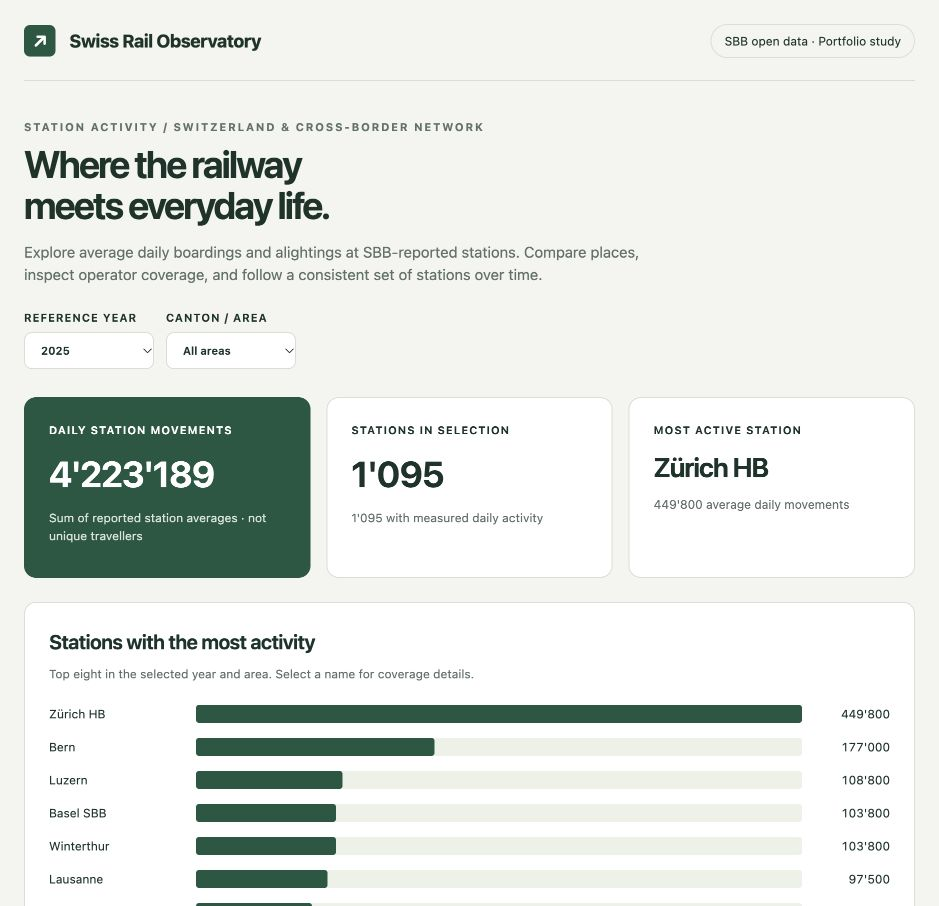

# Data Engineering Portfolio

An Azure data pipeline for Swiss rail station activity, alongside coursework from the [DataTalksClub 2026 cohort](https://github.com/DataTalksClub/data-engineering-zoomcamp/tree/main/cohorts/2026).

## Swiss Rail Observatory

[Project and architecture](capstone/README.md) · [Execution evidence](capstone/evidence/cloud-verification.json) · [Module results](docs/progress.md)

The capstone turns SBB open data into a warehouse and dashboard for comparing station activity across areas and years. A containerized Prefect job extracts the data into ADLS Gen2, builds and tests dbt models in DuckDB, publishes serving tables to Azure SQL, and exports an interactive HTML snapshot. Terraform manages the Azure infrastructure; managed identity provides passwordless access.



- **5,724 station-year records** covering 1,178 stations across five reference years.
- **Six dbt models and 12 data tests**, plus checks for incomplete exports, duplicate keys and unsafe dashboard text.
- **Transactional SQL publication**, with rollback and replay verified against the deployed database.
- **Managed Azure execution verified on 25 November 2026**; downloaded dashboard data reconciled with SQL. A monthly schedule is configured.

The metric is average daily boardings plus alightings, not unique travellers. The dashboard retains operator coverage notes and compares a consistent cohort of 1,068 stations over time.

## View the dashboard

From the repository root:

```bash
make capstone-dashboard
```

Open <http://127.0.0.1:8095>. The included snapshot works without an Azure account; it can also be opened directly from `capstone/dashboard/index.html`. It is not a live hosted service.

## Run the coursework

Each module has its own setup and execution instructions. Start with Docker Desktop and Python, then run:

```bash
make check
make module1-run      # downloads inputs and replaces the two local homework tables
make module1-query    # reruns SQL against the loaded database
make module1-stop     # stops services and preserves data
```

## Repository guide

| Location | Purpose |
| --- | --- |
| [01-docker-terraform](01-docker-terraform/README.md) | Module 1 solutions, ingestion code, SQL, and original GCP Terraform |
| [02-workflow-orchestration](02-workflow-orchestration/README.md) | Kestra workflows, source measurements and observed homework answers |
| [workshops/dlt](workshops/dlt/README.md) | Paginated API ingestion, DuckDB, normalized book metadata and result evidence |
| [03-data-warehouse](03-data-warehouse/README.md) | Source checks and executable BigQuery SQL; cloud measurements pending |
| [04-analytics-engineering](04-analytics-engineering/README.md) | Full production dbt build, 34 data tests and observed answers |
| [05-data-platforms](05-data-platforms/README.md) | Verified Bruin pipeline, quality checks and rerun evidence |
| [06-batch](06-batch/README.md) | Local Spark batch analysis |
| [07-streaming](07-streaming/README.md) | Verified Redpanda/PyFlink/PostgreSQL windows and replay checks |
| [docs/progress.md](docs/progress.md) | Verified results and remaining limitations |
| [capstone](capstone/README.md) | Swiss Rail Observatory: Azure pipeline, SQL warehouse, tests and dashboard |
| [scripts/check_environment.py](scripts/check_environment.py) | Local prerequisite check; optionally checks Azure CLI login |

## Scope and verification

The local coursework includes a 14-table Kestra backfill, a full dbt production build over 160 million raw taxi rows, incremental Bruin loads, Spark batch analysis and Flink event-time windows. Detailed counts, commands and results are linked from each module.

GCP deployments and BigQuery scan measurements remain unverified because the GCP trial expired. The streaming session-window result differs from the homework's listed choices; the measured result and comparison are documented. See [progress and limitations](docs/progress.md).

Course-derived code and datasets are credited in the relevant modules. The Azure capstone uses [SBB Personenverkehr open data](https://data.sbb.ch/explore/dataset/passagierfrequenz/); NYC taxi data is used for coursework.
