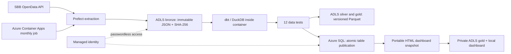

# Swiss Rail Observatory

**Verified in Azure on 25 November 2026.** Execution `job-swiss-rail-3evilpd` succeeded with managed identity. Independent checks matched its private dashboard to all SQL table counts. [Cloud verification](evidence/cloud-verification.json) records the execution, source hash and artifact hash.

An Azure portfolio project that turns SBB station-usage open data into a tested warehouse and an interactive dashboard. It asks which stations have the most activity, how activity differs across areas, and how a consistent group of stations changes across the available reference years.

## Architecture



Terraform provisions the lake, registry, managed identity, SQL database and job environment. SQL uses the smallest Basic tier for this dataset; transformation compute runs only during the container job. The job schedule is monthly, on the first day at 06:00 UTC. No always-on VM, Spark cluster, or public database password is needed.

The lake and container resources are in Switzerland North. This trial subscription rejected SQL provisioning there and in West Europe, so SQL is configured for France Central. The deployment therefore spans Switzerland North and France Central.

## Data contract

Source: [SBB Personenverkehr, station usage](https://data.sbb.ch/explore/dataset/passagierfrequenz/). The initial snapshot has 5,724 station-year records and 1,178 distinct station codes across 2018, 2022, 2023, 2024 and 2025. The extract validates required fields, unique station/year keys, and the record count advertised by the API. Attribution is required by the source's published reuse terms.

The metrics are **average daily boardings plus alightings**, with separate weekday and non-working-day averages. They are not unique people or annual passenger totals. Transfers can count twice. Rail-operator coverage changes; other transport modes and station passers-by are excluded. Some reported stations are abroad. The station detail panel retains the source's coverage notes.

The 1,068-station common cohort includes only stations with nonnull daily activity in every reference year. This controls changes in station membership, not changes in operator coverage. The dataset has gaps between observed years; no values are invented for missing years.

## Models

| Model | Grain | Purpose |
|---|---|---|
| `stg_station_usage` | Station/reference year | Typed fields and consistent names |
| `dim_station` | Station | Most recent descriptive attributes |
| `fct_station_usage` | Station/reference year | Daily, weekday and non-working-day activity |
| `mart_station_year` | Station/reference year | Historical names, areas and coverage alongside metrics |
| `mart_canton_year` | Area/reference year | Station counts and sums of reported station averages |
| `mart_common_cohort_year` | Reference year | Comparable station membership over time |

The tests check keys, relationships, nonnegative measurements, fact/source row reconciliation, area aggregation counts and constant cohort size. Azure SQL uses unique clustered indexes at each model’s grain; year-first keys support year-filtered reporting. Partitioning a 5,724-row fact would add complexity without a useful scale benefit, so this small warehouse is deliberately unpartitioned. The publication uploads versioned Parquet, bulk-copies all five serving tables into staging tables and checks counts. It swaps those tables in one SQL transaction under an application lock. A failed SQL transaction rolls back, preserving the previous publication. Bronze objects are addressed by content hash and an existing object's hash/size must match on replay.

SQL publication and blob dashboard publication are separate transactions. If the latter fails, SQL can be newer than the dashboard until a successful retry. The dashboard carries its source hash and export time. This small full-snapshot pipeline intentionally avoids a complex CDC system.

## Run locally

```bash
cd capstone
uv venv --python 3.13 .venv
uv pip install --python .venv/bin/python -r requirements-lock.txt
.venv/bin/python code/pipeline.py --local
```

This runs the real public API extraction and dbt tests, but skips Azure publication. For cloud execution, authenticate with `az login`, deploy [the infrastructure](infra/azure/README.md), and save its output:

```bash
cd infra/azure
terraform output -json runtime_config > ../../config.local.json
cd ../..
.venv/bin/python -c 'import sys; sys.path.insert(0,"code"); from cloud import initialize_sql; initialize_sql()'
.venv/bin/python code/pipeline.py
```

Local SQL commands require `operator_ipv4` to be set to your current public IPv4 address in Terraform; review/apply that narrow firewall rule first and remove it when finished. The temporary rule was removed after verification. Scheduled Azure jobs continue to use the Azure-services rule.

The initialization maps the managed identity client ID to a contained SQL user and grants table-creation plus read/write/alter rights only in the `analytics` schema. Azure resource RBAC separately uses its principal/object ID. See [Microsoft’s SID-based user guidance](https://learn.microsoft.com/en-us/sql/t-sql/statements/create-user-transact-sql?view=sql-server-ver16). Local execution uses the signed-in Azure CLI identity; the deployed job uses its managed identity. `config.local.json` contains resource names and IDs, not secrets, and is ignored by Git. Tokens, Terraform state and data caches must stay untracked.

## Dashboard

Open `dashboard/index.html` after a successful cloud run, or serve it with `python3 -m http.server 8095 --directory dashboard --bind 127.0.0.1`. The HTML embeds a snapshot queried back from Azure SQL; it does not make live SQL requests or contain credentials. Its year/area filters, station search, coverage details and CSV export work offline. `dashboard/template.html` is the source; `code/render_dashboard.py` injects the data safely.

Every cloud run also writes the dashboard to the private gold filesystem. There is no public website deployment. A refreshed private artifact can be downloaded using the signed-in account. The stable `current.html` path is only updated after successful data processing.

## Verification and operations

Evidence is saved under `evidence/`, with separate records for local DuckDB runs, ADLS Gen2/Azure SQL publication and managed container execution. Local dbt passed 18 nodes (six models and 12 tests), source-contract tests passed, and actual SQL rollback/replay checks passed. The managed Azure run also completed the extraction, lake checksum check, dbt build, SQL publication and dashboard export. The monthly schedule is configured; a future scheduled trigger has not yet been observed. See the root [progress report](../docs/progress.md) for limitations.

The source is small enough for full-snapshot replacement. Retries cover transient extraction/publication failures; dbt failures stop publication. Prefect's temporary local server provides orchestration inside each job, not durable cross-run Prefect history. Azure execution status and private verification objects preserve run-level evidence; logs are retained in Log Analytics for 30 days.

Trial credit is the operating budget. Do not upgrade billing to run this project. SQL and the Basic container registry incur ongoing charges while provisioned, even between job executions; stop/delete resources through a reviewed Terraform plan when finished. The original trial expiry shown in the portal was 22 December 2026. The monthly schedule is not a spending cap and a budget alert would not stop charges automatically.
